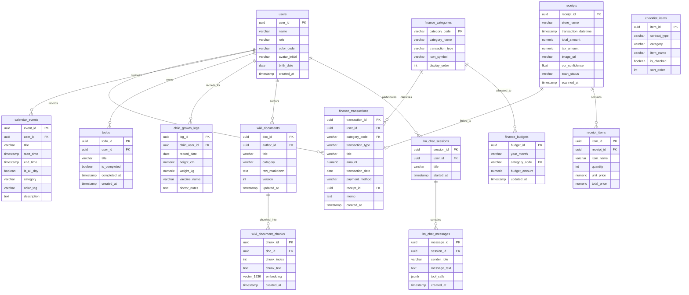

# 🗄️ 가족 LLM WIKI & 가계/영수증 데이터베이스 정의서 (Database & ERD Specification)

- **엔진**: PostgreSQL 16
- **확장 기능**: `pgvector` (벡터 유사도 검색), `uuid-ossp` (고유 식별자 생성)
- **문자 인코딩**: UTF-8
- **시간대(Timezone)**: Asia/Seoul (UTC+9)

---

## 1. 전체 ERD 다이어그램 (Entity-Relationship Diagram)



---

## 2. 테이블별 상세 스키마 정의 (Data Dictionary)

### 2.1 가족 구성원 테이블 (`users`)
| 컬럼명 | 데이터 타입 | 제약 조건 | 설명 |
| :--- | :--- | :--- | :--- |
| `user_id` | `UUID` | `PRIMARY KEY, DEFAULT gen_random_uuid()` | 구성원 고유 식별자 |
| `name` | `VARCHAR(50)` | `NOT NULL` | 구성원 이름 (지훈, 민서, 하늘, 바다) |
| `role` | `VARCHAR(20)` | `NOT NULL` | 역할 (`ADMIN`, `MEMBER`, `CHILD`) |
| `color_code` | `VARCHAR(20)` | `NOT NULL` | 대표 태그 색상 Hex (예: `#4299E1`) |
| `avatar_initial` | `VARCHAR(5)` | `NOT NULL` | 아바타 표시 문자 (예: "하", "바") |
| `birth_date` | `DATE` | `NULL` | 생년월일 (성장 레벨/태어난 일수 연산용) |
| `created_at` | `TIMESTAMPTZ` | `DEFAULT CURRENT_TIMESTAMP` | 등록 일시 |

### 2.2 가계 수입/지출 원장 (`finance_transactions`)
| 컬럼명 | 데이터 타입 | 제약 조건 | 설명 |
| :--- | :--- | :--- | :--- |
| `transaction_id`| `UUID` | `PRIMARY KEY, DEFAULT gen_random_uuid()` | 거래 고유 식별자 |
| `user_id` | `UUID` | `REFERENCES users(user_id) ON DELETE SET NULL` | 거래 발생/등록인 |
| `category_code` | `VARCHAR(30)` | `NOT NULL, REFERENCES finance_categories(category_code)`| 분류 코드 (식비, 육아/교육 등) |
| `transaction_type`| `VARCHAR(10)` | `CHECK (transaction_type IN ('INCOME', 'EXPENSE'))` | 수입/지출 구분 |
| `title` | `VARCHAR(100)`| `NOT NULL` | 항목명 / 가맹점명 |
| `amount` | `NUMERIC(12, 0)`| `NOT NULL, CHECK (amount > 0)` | 거래 금액 (원화 기준 정수) |
| `transaction_date`| `DATE` | `NOT NULL` | 실제 결제/거래 일자 |
| `payment_method`| `VARCHAR(30)` | `NOT NULL` | 결제 수단 (신한카드, 현금, 이체 등) |
| `receipt_id` | `UUID` | `NULL, REFERENCES receipts(receipt_id) ON DELETE SET NULL`| 연결된 OCR 영수증 ID |
| `memo` | `TEXT` | `NULL` | 추가 메모 |
| `created_at` | `TIMESTAMPTZ` | `DEFAULT CURRENT_TIMESTAMP` | 데이터 생성 일시 |

### 2.3 영수증 메타 및 OCR 테이블 (`receipts`)
| 컬럼명 | 데이터 타입 | 제약 조건 | 설명 |
| :--- | :--- | :--- | :--- |
| `receipt_id` | `UUID` | `PRIMARY KEY, DEFAULT gen_random_uuid()` | 영수증 고유 식별자 |
| `store_name` | `VARCHAR(100)`| `NOT NULL` | OCR 인식 상호명 |
| `transaction_datetime`| `TIMESTAMPTZ`| `NOT NULL` | 영수증 결제 일시 |
| `total_amount` | `NUMERIC(12, 0)`| `NOT NULL` | 최종 승인 금액 |
| `tax_amount` | `NUMERIC(12, 0)`| `DEFAULT 0` | 부가세 |
| `image_url` | `VARCHAR(255)`| `NULL` | 업로드 원본 영수증 이미지 경로 |
| `ocr_confidence`| `FLOAT` | `CHECK (ocr_confidence BETWEEN 0 AND 1)` | OCR 인식 신뢰도 점수 |
| `scan_status` | `VARCHAR(20)` | `DEFAULT 'PARSED'` | 상태 (`PENDING`, `PARSED`, `CONFIRMED`) |
| `scanned_at` | `TIMESTAMPTZ` | `DEFAULT CURRENT_TIMESTAMP` | 스캔 일시 |

### 2.4 영수증 세부 품목 테이블 (`receipt_items`)
| 컬럼명 | 데이터 타입 | 제약 조건 | 설명 |
| :--- | :--- | :--- | :--- |
| `item_id` | `UUID` | `PRIMARY KEY, DEFAULT gen_random_uuid()` | 품목 고유 식별자 |
| `receipt_id` | `UUID` | `NOT NULL, REFERENCES receipts(receipt_id) ON DELETE CASCADE`| 소속 영수증 ID |
| `item_name` | `VARCHAR(100)`| `NOT NULL` | 구매 상품 품목명 |
| `quantity` | `INT` | `DEFAULT 1, CHECK (quantity > 0)` | 구매 수량 |
| `unit_price` | `NUMERIC(12, 0)`| `NOT NULL` | 개당 단가 |
| `total_price` | `NUMERIC(12, 0)`| `NOT NULL` | 소계 금액 |

### 2.5 가족 WIKI 원본 문서 (`wiki_documents`)
| 컬럼명 | 데이터 타입 | 제약 조건 | 설명 |
| :--- | :--- | :--- | :--- |
| `doc_id` | `UUID` | `PRIMARY KEY, DEFAULT gen_random_uuid()` | WIKI 문서 ID |
| `author_id` | `UUID` | `REFERENCES users(user_id) ON DELETE SET NULL` | 작성자 |
| `title` | `VARCHAR(150)`| `NOT NULL` | 문서 제목 |
| `category` | `VARCHAR(50)` | `NOT NULL` | 카테고리 (육아/건강, 가계/재정 등) |
| `raw_markdown`| `TEXT` | `NOT NULL` | 마크다운 원문 텍스트 |
| `version` | `INT` | `DEFAULT 1` | 문서 개정 판번호 |
| `updated_at` | `TIMESTAMPTZ` | `DEFAULT CURRENT_TIMESTAMP` | 최종 수정 일시 |

### 2.6 RAG 지식 청크 및 pgvector 벡터 테이블 (`wiki_document_chunks`)
| 컬럼명 | 데이터 타입 | 제약 조건 | 설명 |
| :--- | :--- | :--- | :--- |
| `chunk_id` | `UUID` | `PRIMARY KEY, DEFAULT gen_random_uuid()` | 청크 식별자 |
| `doc_id` | `UUID` | `NOT NULL, REFERENCES wiki_documents(doc_id) ON DELETE CASCADE`| 원본 문서 외래키 |
| `chunk_index` | `INT` | `NOT NULL` | 문서 내 청크 순번 |
| `chunk_text` | `TEXT` | `NOT NULL` | 분할된 본문 조각 (500~1000자) |
| `embedding` | `vector(1536)`| `NOT NULL` | OpenAI/로컬 임베딩 1536차원 벡터 |
| `created_at` | `TIMESTAMPTZ` | `DEFAULT CURRENT_TIMESTAMP` | 색인 일시 |

---

## 3. 인덱싱 전략 (Indexing Strategy)

1. **HNSW 벡터 인덱스 (pgvector)**:
   ```sql
   CREATE INDEX idx_wiki_embedding_hnsw 
   ON wiki_document_chunks 
   USING hnsw (embedding vector_cosine_ops)
   WITH (m = 16, ef_construction = 64);
   ```
   - **목적**: LLM 질의 시 코사인 유사도 검색 속도를 10ms 이하로 단축.
2. **복합 인덱스 (가계부 집계 최적화)**:
   ```sql
   CREATE INDEX idx_finance_trans_date_cat 
   ON finance_transactions (transaction_date DESC, category_code, transaction_type);
   ```
   - **목적**: 월간 수입/지출 KPI 및 카테고리 통계 집계 쿼리 최적화.
3. **일정 조회 인덱스**:
   ```sql
   CREATE INDEX idx_calendar_event_timerange 
   ON calendar_events (start_time, end_time);
   ```

